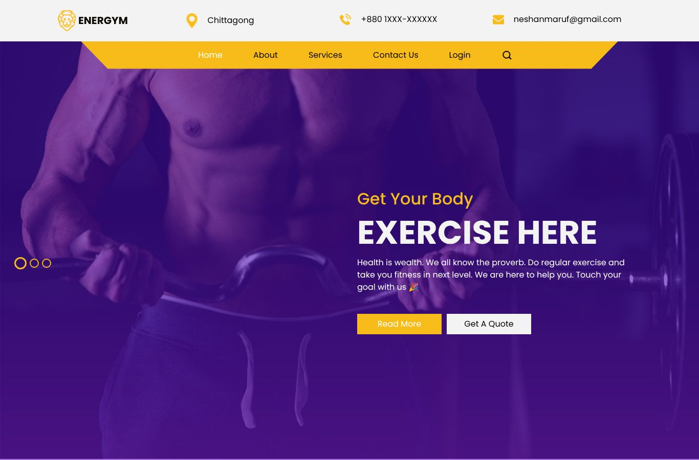
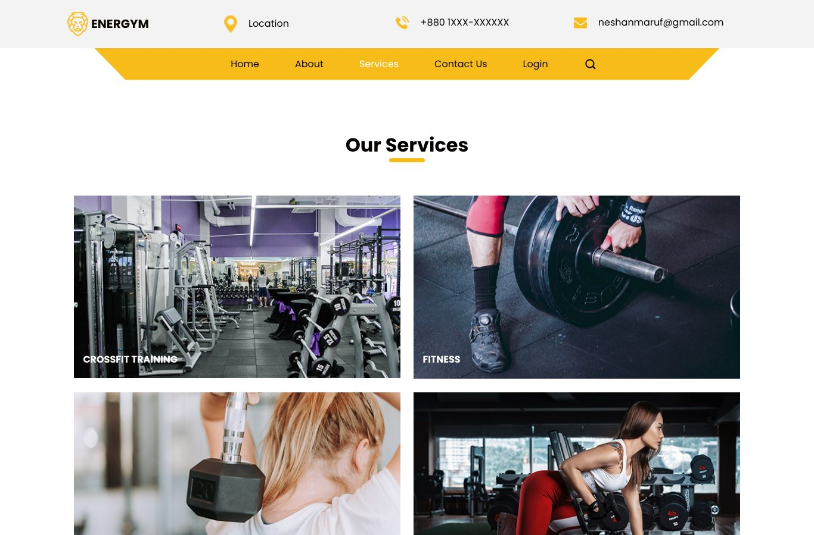
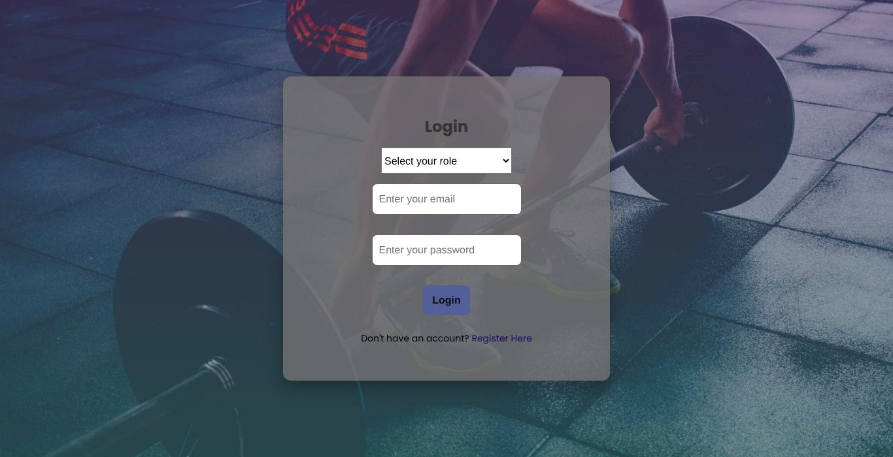

# Gym Management System

A gym website with pages for the gym's services, an about page, a contact page, and login and registration pages for members. Built with HTML, CSS and Bootstrap.




## Pages

| Page | File | What it shows |
|---|---|---|
| Home | `index.html` | Hero slider, about, services, why choose us, results, client reviews and a contact form |
| About | `about.html` | About the gym |
| Services | `service.html` | CrossFit training, fitness, strength training, health, workout and strategies |
| Contact | `contact.html` | Contact form and gym details |
| Login | `log_in_form.html` | Login with a role: admin, trainer or user |
| Register | `register_form.html` | New member sign-up with age, gender, weight and height |

| Services | Login |
|---|---|
|  |  |

## Run it

No installation needed. Download or clone the repository and open `index.html` in a browser.

## Folder structure

```
Gym-Management-System/
├── index.html, about.html, service.html, contact.html
├── log_in_form.html, register_form.html
├── css/           # Bootstrap, main styles (style.scss -> style.css), login/register styles
├── images/        # photos and icons
└── screenshots/   # images used in this README
```

## Status

The website front end is ready. The login and registration forms are designed, and the back end (saving members and checking logins for admin, trainer and user) is the next step.

## Credits

- Design and development: **Maruf & Alok Roy**
- Based on the free *Energym* HTML template from [html.design](https://html.design/)
